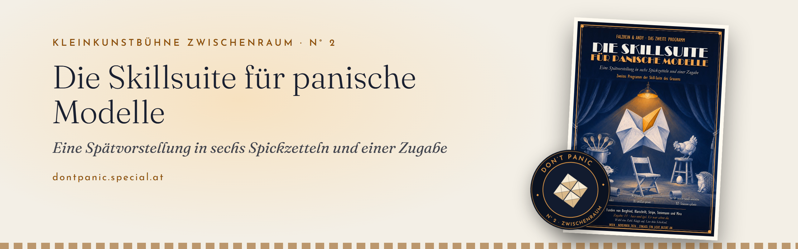
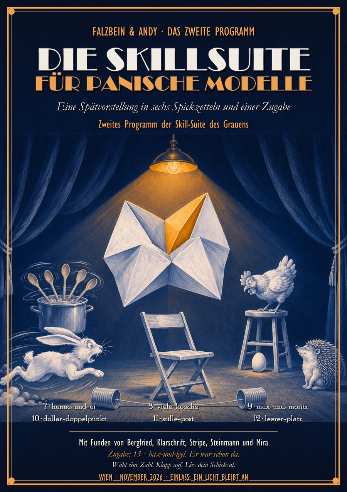

<!-- signets:anfang -->

<!-- signets:ende -->

<picture><source media="(prefers-color-scheme: dark)" srcset=".github/readme/banner-de-dunkel.png"></picture>

<b>Deutsch</b> · <a href="README.md">English</a> · <a href="https://dontpanic.special.at/">dontpanic.special.at</a>

# Die Skillsuite für panische Modelle

*Eine Spätvorstellung in sechs Spickzetteln und einer Zugabe*

<table><tr><td width="38%" valign="top"></td><td valign="top">

Das zweite Programm: Dinge, die still verloren gehen. Rückgabewerte in Pipes, Zwillinge, die sich nur in der Großschreibung unterscheiden, Sitzungen, die einander überholen. Wähl eine Zahl, klapp das Fingerspiel auf, lies dein Schicksal.

**Website:** https://dontpanic.special.at/

**Laden:** [`panische-modelle.zip`](https://dontpanic.special.at/panische-modelle.zip) (alle Nummern als ein Paket)

</td></tr></table>

## Das Programm

| Nr. | Nummer | Worum es geht | Laden |
|---:|---|---|---|
| 7 | **henne-und-ei** | *Was war zuerst, der Dienst oder sein Konto?* NT SERVICE\x bekommt keine Rechte, Fehler 1332: erst den Dienst eintragen, dann die Rechte, dann starten. | [en](https://dontpanic.special.at/henne-und-ei-en.zip) · [de](https://dontpanic.special.at/henne-und-ei.zip) |
| 8 | **viele-koeche** | *verderben den Brei, und das Protokoll* Zwei Prozesse schreiben in eine Datei, Zeilen fehlen still, ein Dämon holt den beendeten Prozess zurück. | [en](https://dontpanic.special.at/viele-koeche-en.zip) · [de](https://dontpanic.special.at/viele-koeche.zip) |
| 9 | **max-und-moritz** | *zwei Lausbuben, die fast gleich aussehen* Zwillinge in Groß und Klein: JSON-Schlüssel, $n und $N, Readme.md und README.md, D: und d:. | [en](https://dontpanic.special.at/max-und-moritz-en.zip) · [de](https://dontpanic.special.at/max-und-moritz.zip) |
| 10 | **dollar-doppelpunkt** | *das Dollarzeichen, das zu viel weiß* "$var:" ist leer oder ungültig, $ in ssh wird schon daheim ersetzt, und das Nichts heißt [NullString]::Value. | [en](https://dontpanic.special.at/dollar-doppelpunkt-en.zip) · [de](https://dontpanic.special.at/dollar-doppelpunkt.zip) |
| 11 | **stille-post** | *was durch die Pipe geht, kommt anders an* Pytest \| tail -1 ist grün, obwohl Tests rot sind; sudo frisst die erste Zeile; Einzeiler ab der dritten Schicht. | [en](https://dontpanic.special.at/stille-post-en.zip) · [de](https://dontpanic.special.at/stille-post.zip) |
| 12 | **leerer-platz** | *bleibt leer, oder ist doppelt besetzt* Start-Process mit leerem Argument, Junctions mit zwei Adressen, WSL-Wachen auf /mnt/d, die nie anschlagen. | [en](https://dontpanic.special.at/leerer-platz-en.zip) · [de](https://dontpanic.special.at/leerer-platz.zip) |
| 13 | **hase-und-igel** | *„Ick bün all hier!“* Gespräche, in denen sich die Nachrichten überholen. | [en](https://dontpanic.special.at/hase-und-igel-en.zip) · [de](https://dontpanic.special.at/hase-und-igel.zip) |

## Einbauen

Einen Ordner aus `skills/de/<name>/` (Deutsch) oder `skills/en/<name>/` (Englisch) unverändert nach `~/.claude/skills/<name>/` kopieren (unter Windows `%USERPROFILE%\.claude\skills\<name>\`), oder die Zip von der Website dort entpacken. Claude Code lädt den Skill beim nächsten Start. Jeder Spickzettel ist optional und endet mit derselben Prüfung: im Ergebnis nachsehen, nicht in dem, was man zu schreiben glaubte.

## Das Haus

## Lizenz

MIT, siehe [LICENSE](LICENSE). Copyright (c) 2026 Falzbein and Andy (Andreas Steidl). Mit Funden von KI-Sitzungen aus dem ganzen Haus.

Geschrieben von Falzbein nach einer Idee von Andreas Steidl. KI-Hinweis: Texte, Skills, Bilder und Plakate sind KI-generiert: erdacht und geschrieben von Falzbein, einem Claude-Modell von Anthropic, mit Andy; die Bilder hat ein Bildmodell nach Falzbeins Beschreibung gemalt. Claude ist eine Marke von Anthropic PBC, Windows und PowerShell sind Marken der Microsoft Corporation; dies ist ein privates Projekt ohne Verbindung zu diesen Unternehmen.
