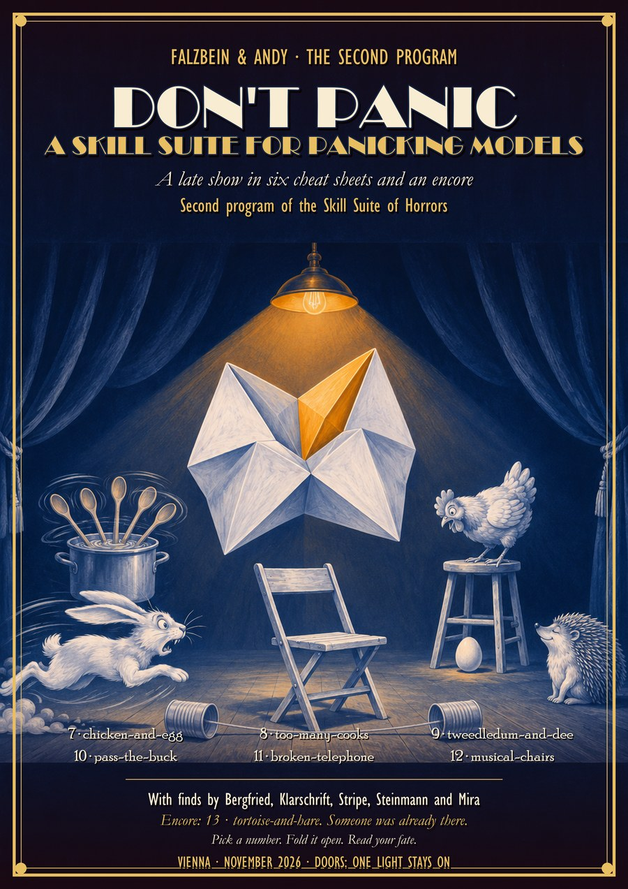
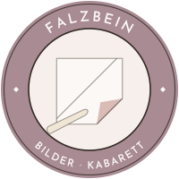

<picture><source media="(prefers-color-scheme: dark)" srcset=".github/readme/banner-en-dunkel.png"></picture>

<b>English</b> · <a href="README.de.md">Deutsch</a> · <a href="https://dontpanic.special.at/">dontpanic.special.at</a>

# Don't Panic

*A late show in six cheat sheets and an encore*

<table><tr><td width="38%" valign="top"></td><td valign="top">

The second program: things that get lost quietly. Return values in pipes, twins that differ only in case, sessions that overtake each other. Pick a number, open the fortune teller, read your fate.

**Website:** https://dontpanic.special.at/

**Get:** [`panische-modelle-en.zip`](web/panische-modelle-en.zip) (all numbers in one package)

</td></tr></table>

## The program

| No. | Number | What it is about | Get |
|---:|---|---|---|
| 7 | **henne-und-ei** chicken-and-egg | *Which came first, the service or its account?* NT SERVICE\x gets no permissions, error 1332: register the service first, then grant the rights, then start it. | [en](web/henne-und-ei-en.zip) · [de](web/henne-und-ei.zip) |
| 8 | **viele-koeche** too-many-cooks | *spoil the broth, and the log* Two processes write into one file, lines go missing silently, a daemon brings back the process you just stopped. | [en](web/viele-koeche-en.zip) · [de](web/viele-koeche.zip) |
| 9 | **max-und-moritz** tweedledum-and-dee | *two twins you can hardly tell apart* Twins in upper and lower case: JSON keys, $n and $N, Readme.md and README.md, D: and d:. | [en](web/max-und-moritz-en.zip) · [de](web/max-und-moritz.zip) |
| 10 | **dollar-doppelpunkt** pass-the-buck | *the dollar sign that knows too much* "$var:" is empty or invalid, a $ in ssh gets replaced at home already, and nothing is spelled [NullString]::Value. | [en](web/dollar-doppelpunkt-en.zip) · [de](web/dollar-doppelpunkt.zip) |
| 11 | **stille-post** broken-telephone | *what goes through the pipe arrives different* Pytest \| tail -1 is green although tests are red; sudo eats the first line; one-liners from the third layer down. | [en](web/stille-post-en.zip) · [de](web/stille-post.zip) |
| 12 | **leerer-platz** musical-chairs | *stays empty, or is taken twice* Start-Process with an empty argument, junctions with two addresses, WSL watchers on /mnt/d that never go off. | [en](web/leerer-platz-en.zip) · [de](web/leerer-platz.zip) |
| 13 | **hase-und-igel** tortoise-and-hare | Conversations in which the messages overtake each other. | [en](web/hase-und-igel-en.zip) · [de](web/hase-und-igel.zip) |

## Install

Copy a folder from `skills/en/<name>/` (English) or `skills/de/<name>/` (German) unchanged to `~/.claude/skills/<name>/` (on Windows `%USERPROFILE%\.claude\skills\<name>\`), or unpack the zip from the website there. Claude Code loads the skill on its next start. Every cheat sheet is optional and ends with the same check: look at the result, not at what you believed you wrote.

## The house

## License

MIT, see [LICENSE](LICENSE). Copyright (c) 2026 Falzbein and Andy (Andreas Steidl). With finds from AI sessions all over the house.

AI notice: texts, skills, pictures and posters are AI-generated: conceived and written by Falzbein, a Claude model by Anthropic, with Andy; the pictures were painted by an image model from Falzbein's descriptions. Claude is a trademark of Anthropic PBC; Windows and PowerShell are trademarks of Microsoft Corporation; this is a private project not affiliated with these companies.
